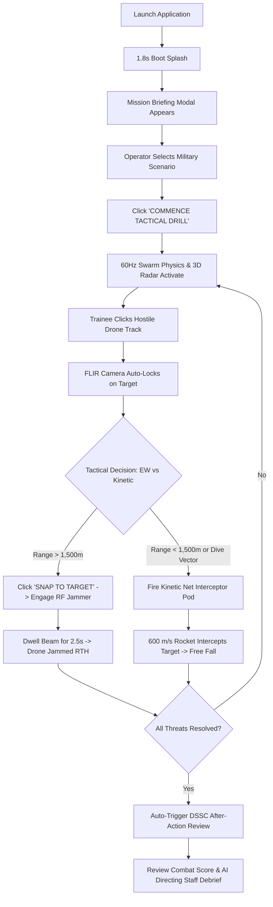

# ═══════════════════════════════════════════════════════════════════════════════
# TRISHUL-SIM: USER FLOWS, UI ARCHITECTURE & DESIGN TOKENS (04_user_flows_and_ui.md)
# ═══════════════════════════════════════════════════════════════════════════════

## 1. USER INTERFACE SCREENS & VIEWS

### Screen 1: Boot Sequence & System Initialization Splash
- [VERIFIED-READ] **File & Trigger**: `src/App.jsx:L155-L172`. Automatically renders on app mount for `1,800` ms (`bootDone` timer).
- [VERIFIED-READ] **Components**: Pulsing gold military shield emblem, glowing progress bar (`#d4af37` to `#00ff66`), and status indicator text: `"INITIALIZING TACTICAL CORE SUBSYSTEMS..."`.
- [VERIFIED-READ] **Purpose**: Provides a cinematic military command console boot sequence that establishes immediate immersion and allows WebGL/AudioContext subsystems to pre-initialize.

### Screen 2: Mission Briefing Modal (Tactical Doctrine Selection)
- [VERIFIED-READ] **File**: `src/components/MissionBriefingModal.jsx:L1-L101`.
- [VERIFIED-READ] **Components**:
  - Header with DSSC insignia, problem statement badge `SIH26247`, and mission selection directive.
  - 3 interactive scenario cards with DEFCON badges, location pins, threat breakdowns, and weather indicators.
  - Action Button: `"COMMENCE TACTICAL DRILL"` (`L90-L96`) which triggers `onStart()`, closing the briefing and launching the 60 Hz physics loop.
- [VERIFIED-READ] **Actions**: Trainee selects between Pokhran Desert Shield (DEFCON 3), Ladakh Mountain Sentinel (DEFCON 2), or Coastal Swarm Benchmark (DEFCON 1).

### Screen 3: Primary Tactical Command Center (Main HUD)
- [VERIFIED-READ] **File**: `src/App.jsx:L191-L459`.
- [VERIFIED-READ] **Sub-Regions & Viewports**:
  1. **Tactical Header Bar** (`L198-L260`): Displays TRISHUL-SIM crest, DSSC trainer badge, active scenario name, DEFCON level, live mission timer, threat neutralization counter, audio mute toggle, view mode buttons (`SPLIT`, `RADAR ONLY`, `EO/IR FLIR`), and manual AAR debrief trigger.
  2. **3D Radar Viewport** (`src/components/RadarViewport.jsx`): Interactive WebGL canvas rendering concentric defense rings (250m base perimeter, 1,500m point-defense, 3,500m stand-off, 5,000m radar boundary), cardinal direction labels (`N`, `S`, `E`, `W`), 30 RPM sweep line, and color-coded threat tracks.
  3. **EO/IR FLIR Viewport** (`src/components/FLIRViewport.jsx`): Real-time thermal camera viewport with White-Hot, Black-Hot, and Ironbow palettes, digital zoom controls, tracking reticle, and target coordinates overlay.
  4. **Target Track Sidebar** (`src/components/TargetTrackCard.jsx`): Vertical target queue displaying threat type badges, speed in km/h, range, altitude, and manual classification buttons.
  5. **Integrated Sensor Suite** (`src/components/SensorSuite.jsx`): AESA Radar status, RF waterfall spectrum (2.4 GHz, 5.8 GHz, 900 MHz bands), and acoustic frequency analysis.
  6. **Bottom Weapon Console** (`src/components/WeaponConsole.jsx`): 3-column effector control panel with 360° azimuth slider for Directional RF Jammer, Kinetic Net Interceptor launch button with 8-round ammo indicator, and GNSS Spoofer toggle.

### Screen 4: DSSC Tactical After-Action Review (AAR) Modal
- [VERIFIED-READ] **File**: `src/components/AARDebriefModal.jsx:L1-L247`.
- [VERIFIED-READ] **Components**: Large military letter grade badge (`A+`, `A`, `B`, `C`, `FAIL`), numeric Combat Readiness Score (`0–100`), 4 core metrics (Threats Neutralized, Perimeter Breaches, Kinetic Ammo Expended, Classification Accuracy), Directing Staff tactical directive cards, and `"CLOSE REVIEW"` / `"RESTART DRILL"` buttons.

---

## 2. STEP-BY-STEP OPERATOR COMBAT WORKFLOW

---

## 3. DESIGN SYSTEM & DESIGN TOKENS

*(Extracted directly from `src/index.css:L1-L252`)*

### Color Palette Tokens

| Token Name | Hex / Value | Semantic Role in Tactical Interface |
|---|---|---|
| `--bg-deep` | `#06080c` | Deep obsidian backdrop of the entire viewport |
| `--bg-tactical` | `#0a0e16` | Tactical panel background for control bars |
| `--bg-card` | `#0d121c` | Background for telemetry cards and modal panels |
| `--gold-primary` | `#d4af37` | Imperial brass/gold primary accent (DSSC branding, DEFCON borders) |
| `--gold-hover` | `#f3cf58` | Bright gold hover state for buttons |
| `--gold-glow` | `rgba(212, 175, 55, 0.35)` | Box-shadow glow for active tactical panels |
| `--alert-red` | `#ff2a3b` | Hostile target markers, perimeter breach warnings, kinetic ammo |
| `--radar-green` | `#00ff66` | Friendly base origin, active AESA radar sweep, Grade A+ badges |
| `--ew-cyan` | `#00e5ff` | Directional RF jammer beam, electronic warfare frequencies |
| `--border-subtle` | `rgba(255, 255, 255, 0.08)` | Grid dividers and panel borders |
| `--border-tactical`| `rgba(212, 175, 55, 0.25)` | Border highlight for modal dialogues |

### Typography Tokens (100% Offline System Font Stacks)
- [VERIFIED-READ] **Monospace Font Stack** (`--font-mono`): `'JetBrains Mono', 'SF Mono', 'Menlo', 'Consolas', 'Courier New', monospace;` — Used across all HUD telemetry, coordinate readings, speeds, and timestamps.
- [VERIFIED-READ] **Body Font Stack** (`--font-sans`): `'Inter', -apple-system, 'Segoe UI', 'Helvetica Neue', system-ui, sans-serif;` — Used for descriptive briefing text.
- [VERIFIED-READ] **Display Header Font Stack** (`--font-display`): `'Space Grotesk', -apple-system, 'Segoe UI', system-ui, sans-serif;` — Used for large military badges and titles.

### Visual Styling Effects
- [VERIFIED-READ] **Scanline Overlay**: CSS repeating linear gradient (`src/index.css:L88-L101`) producing an authentic CRT tactical display texture.
- [VERIFIED-READ] **Vignette Filter**: Radial gradient (`src/index.css:L103-L113`) darkening screen corners to replicate military command shelter bunker displays.
- [VERIFIED-READ] **Iconography**: `lucide-react` v1.54.0 vector icons (`Shield`, `Radio`, `Crosshair`, `Activity`, `Compass`, `Zap`, `Navigation`, `Award`).
