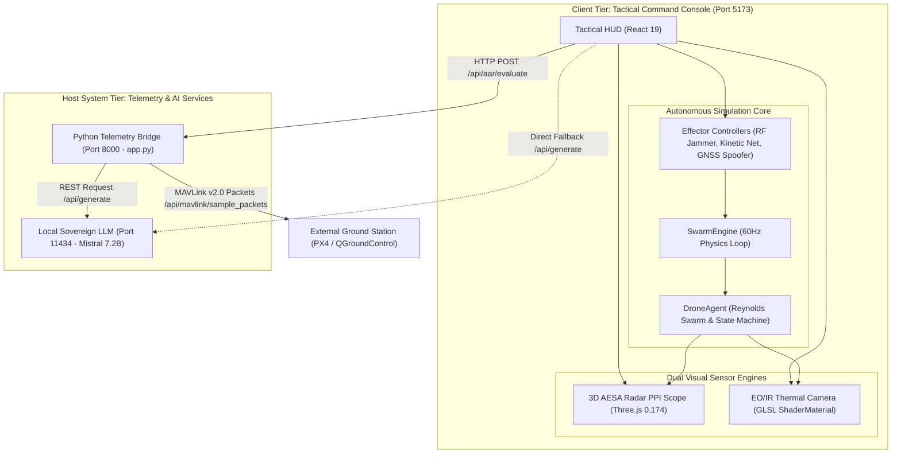
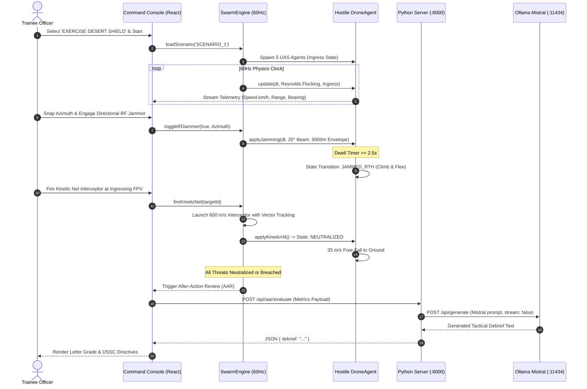

# ═══════════════════════════════════════════════════════════════════════════════
# TRISHUL-SIM: SYSTEM ARCHITECTURE & INTEGRATION FLOWS (05_architecture.md)
# ═══════════════════════════════════════════════════════════════════════════════

## 1. SUBSYSTEM ARCHITECTURAL BREAKDOWN

Project TRISHUL-SIM implements a **two-tier sovereign air-gapped architecture** designed for high-refresh visual simulation and zero-cloud telemetry evaluation:

1. **Client Command & Simulation Tier (Browser Runtime)**:
   - **Physics & Swarm Core** (`src/simulation/SwarmEngine.js`, `DroneAgent.js`): Executes a deterministic 60 Hz Euler kinematics loop calculating multi-agent Reynolds flocking forces, base ingress vectors, jamming dwell timers, and projectile ballistics.
   - **3D AESA Radar Engine** (`src/components/RadarViewport.jsx`): Manages a WebGL Three.js scene utilizing pre-allocated mesh pools (16 drone markers, 16 3D trail buffers) to prevent browser garbage collection spikes.
   - **Thermal Infrared Optical Pipeline** (`src/components/FLIRViewport.jsx`, `src/shaders/thermalShader.js`): A custom GLSL ShaderMaterial simulating electro-optical infrared sensor characteristics (White-Hot / Black-Hot / Ironbow).
   - **Tactical Audio Synthesizer** (`src/App.jsx`): Direct Web Audio API procedural sound generation without external audio media assets.

2. **Backend Telemetry & Sovereignty Tier (Python Server & Ollama)**:
   - **Python Telemetry Bridge** (`server/app.py`): Zero-dependency standard library HTTP/TCP server running on port `8000`. Streams MAVLink v2.0 military packet structures (`GLOBAL_POSITION_INT`, `ATTITUDE`) for integration with military ground control software (QGroundControl, PX4).
   - **Local LLM Directing Staff** (`http://localhost:11434`): On-device Ollama REST server running `mistral:latest` (7.2B parameters) evaluating combat telemetry under strict 15-second abort controller timeouts with local deterministic rule fallback.

---

## 2. MERMAID DIAGRAM (A): HIGH-LEVEL ARCHITECTURE

---

## 3. MERMAID DIAGRAM (B): MISSION ENGAGEMENT & EVALUATION SEQUENCE

---

## 4. COMMUNICATION PROTOCOLS & IPC
- [VERIFIED-READ] **Client Internal State Synchronization**: Unidirectional event notification pattern (`SwarmEngine.notify()`) broadcasting state snapshots to React components.
- [VERIFIED-READ] **Telemetry Serialization Protocol**: MAVLink v2.0 binary packet emulation encoded as JSON structures over standard HTTP REST.
- [VERIFIED-READ] **AI Inference RPC**: Standard HTTP JSON REST POST with `AbortController` cancellation signals (`15,000` ms timeout).
- [VERIFIED-READ] **Cross-Origin Resource Sharing (CORS)**: Pre-flight `OPTIONS` support enabled on both Python bridge (`server/app.py:L55`) and Ollama (`localhost:11434`).
